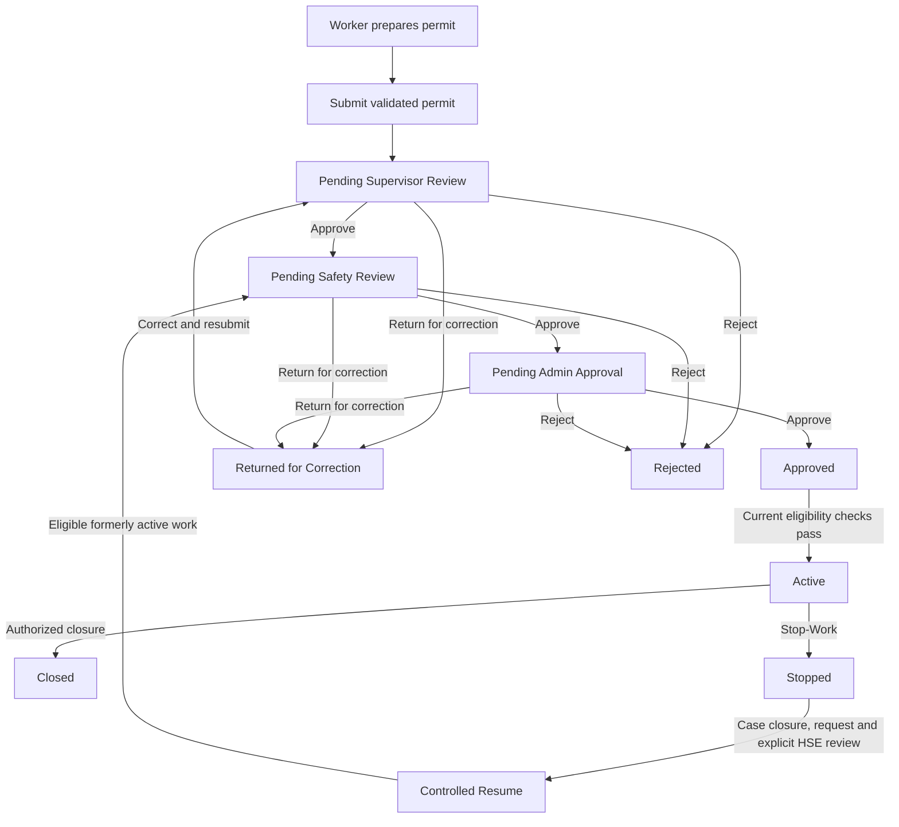
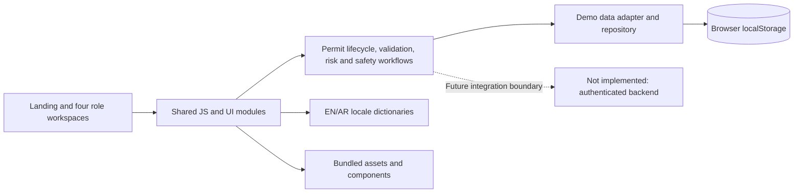

<div align="center">


# SafePermit

### Industrial Permit-to-Work Management · 

**Plan the work. Verify the risks. Approve with evidence. Stay in control.**

A bilingual, role-oriented **Permit-to-Work (PTW) frontend prototype** for exploring how hazardous work can be prepared, reviewed, authorized in stages, monitored, stopped and reconsidered before resumption.

**HTML5 · CSS3 · Vanilla JavaScript · English / العربية · RTL / LTR · No build step**

[Explore the workflow](#permit-lifecycle) · [Features](#capabilities) · [Run locally](#getting-started) · [Architecture](#architecture) · [Testing](#quality-assurance) · [Limitations](#important-prototype-boundaries)

</div>

> [!IMPORTANT]
> **Frontend demonstration — not an operational authorization system.** SafePermit v13.9 does **not** implement real identity verification, server-enforced permissions, a transactional database, durable file uploads, or certified industrial safety controls. Its review, activation, Stop-Work, QR, and AI experiences illustrate intended workflows using browser-local data. **Nothing displayed by this prototype authorizes real work.**

## Overview

High-risk activities require more than a permit form. Workers need to explain *what* will happen, *where*, *when*, *who* is involved and *which hazards and controls* are relevant. Supervisors, Safety/HSE personnel and administrators need a consistent way to examine that evidence, identify outstanding blockers, record their decisions and prevent a permit from being mistaken for an authorization simply because a status label looks positive.

**SafePermit brings those ideas into one connected PTW demonstration:**

- **Preparation:** structured work details, hazard assessment, safety checklist and final review.
- **Accountable review:** sequential Supervisor → Safety Officer → Administrator decisions with recorded evidence.
- **Readiness:** permit validity, approval evidence and active safety blockers assessed separately.
- **Intervention:** integrated SIMOPS/LOTO/competency checks, Stop-Work and explicit HSE-controlled resumption.
- **Visibility:** role-specific dashboards, queues, permit details, notifications, audit views and contextual QR references.
- **Usability:** responsive navigation, bilingual layouts, accessible form feedback, clear save states and restrained motion.

The current project is a **tested, static frontend baseline** intended for demonstration, learning, review and further engineering—not live site operations.

## Capabilities

### Four role-oriented workspaces

| Workspace | What the prototype provides | Entry point |
| --- | --- | --- |
| **Worker** | Dashboard, four-step permit wizard, saved/recoverable drafts, submitted permits, returned-permit correction, approval tracking, permit details, notifications, profile and contextual QR access. | [`worker/dashboard/`](worker/dashboard/) |
| **Supervisor** | Review queue, detailed operational review and decisions, active-work supervision, review history, notifications, dashboard and profile. | [`supervisor/dashboard/`](supervisor/dashboard/) |
| **Safety Officer / HSE** | Safety review queue, risk overview, a multi-module Safety Command Center, Stop-Work handling, controlled resumption, history, notifications, dashboard and profile. | [`safety/dashboard/`](safety/dashboard/) |
| **Administrator** | Final-stage permit review, separate activation and active-permit management, users, sites/areas, permit-type configuration, reports/audit, settings, notifications, dashboard and profile. | [`admin/dashboard/`](admin/dashboard/) |

The role-specific UI demonstrates responsibilities and workflow boundaries. **It is not access control:** demo role selection and direct page URLs are not protected by authenticated server-side authorization.

### Worker permit wizard

The permit journey is organized into four connected steps:

| Step | Purpose | Core behavior |
| --- | --- | --- |
| **01 · Basic Info** | Describe the proposed job, its type, work location, timing, team and responsible persons. | Required-field, date/time and **1–50 workers** validation; accessible error summary; explicit draft recovery. |
| **02 · Risk Assessment** | Record hazards, severity/likelihood, controls and residual risk. | Risk evidence is kept distinct from permit lifecycle status; persistent draft state reports unsaved, saving, saved or failed. |
| **03 · Safety Checklist** | Confirm mandatory controls before proceeding. | Required answers are checked; storage failure does not masquerade as a successful save. |
| **04 · Review & Submit** | Inspect the combined permit and submit the current validated data. | Revalidates Basic Info and applicable safety information, even after editing or restoring a draft; creates a new permit without overwriting existing records. |

Drafts can intentionally contain **unfinished or invalid** information while a person is editing. **Saving a draft is not a safety approval and cannot bypass submission, review or activation validation.**

Example work categories in the wizard include electrical work, hot work, work at height, confined-space entry, excavation and general maintenance. The project also includes configurable demo permit-type data; the exact visible options are determined by the relevant page and local fixtures.

### Integrated Safety Command Center

The Safety workspace includes ten connected areas. These are **browser-local, user-reviewable records and demonstration checks**, not live industrial integrations.

| Area | Demonstrated purpose |
| --- | --- |
| **Risk Register** | Capture hazards, risk ownership, initial and residual scores, controls and review status. |
| **Live Risk Map** | Summarize site/zone risk records; **a zone-oriented view, not a live GIS map**. |
| **Permit Safety Gates** | Track permit-linked checks and required verification evidence. |
| **SIMOPS Conflicts** | Identify potentially overlapping work and require review of unresolved concurrent-work conflicts. |
| **Risk Intelligence** | Surface descriptive indicators and patterns for human interpretation; no live predictive feed. |
| **Digital LOTO** | Record isolation plans, equipment/energy-source controls and verification status. |
| **Safety Passports** | Review competency/training records and expiry-related readiness checks. |
| **Incidents & Near Misses** | Capture incident and investigation information and associated corrective actions. |
| **Compliance Center** | Track findings, owners, due dates, verification evidence and corrective actions. |
| **Stop-Work Center** | Record permit-linked stop cases and conditions relevant to controlled resumption. |

The integrated review considers applicable unverified gates, unresolved stop cases, missing or unverified isolations, competency requirements, residual risk and SIMOPS issues. Unverifiable safety storage is treated as a blocker within the supported demo logic.

### Supporting experiences

- **Operational dashboards:** role-specific status summaries, review priorities and data-derived visualizations; no invented authorization from a dashboard metric.
- **Review and audit trail:** review stage, reviewer, rationale, timestamps, corrections and status transitions; Admin reports include decision summaries, filters and CSV export UI.
- **Permit context and QR:** contextual access to the selected permit and an explicitly **DEMO / UNVERIFIED** verification view; QR presentation is not authenticated approval or site clearance.
- **Draft recovery and feedback:** recovery prompts, safeguards around unsaved edits, truthful persistence outcomes and retry behavior.
- **Notifications and navigation:** responsive sidebars, context-preserving links, filters and distinct empty/error/loading feedback.
- **Advisory AI experiences:** local, deterministic, role-sensitive suggestions. Workers receive guidance; Supervisor, Safety and Admin views highlight omissions or inconsistencies. **AI never submits a human decision, approves, activates or resumes a permit.**
- **Public experience:** cinematic landing page, animated workflow explanation, informational resources, About/Contact pages and a clearly disclosed demo sign-in.

## Permit lifecycle

SafePermit separates **preparing**, **reviewing**, **approving**, **activating** and **monitoring** work. In particular, final Admin approval is **not** the same as activation.



*Simplified explanatory diagram: individual transitions are subject to source-code validation and existing workflow rules. A closed Stop-Work case alone does not resume a permit; a denied resume remains Stopped.*

### Decision and readiness rules

The current demonstration enforces several important domain invariants in its supported code paths:

1. **Ordered review:** a permit progresses through Supervisor → Safety Officer → Administrator; a role cannot simply skip the preceding stage.
2. **Explicit human decisions:** approve, return for correction or reject are associated with the applicable review stage and evidence.
3. **Correction invalidates stale decisions:** a permitted resubmission starts a new review cycle; prior approvals cannot silently carry forward as current authorization.
4. **Worker-count boundary:** the documented range is **1–50**; the rule is checked beyond the first wizard screen, including later submission and safety transitions.
5. **Risk evidence:** the illustrative 1–25 scale groups Low (1–4), Medium (5–9), High (10–16) and Critical (17–25). Applicable approval checks require complete hazards/controls, residual risk **below 10** and lower than the initial risk.
6. **Activation is a fresh decision:** the Admin path rereads the permit and applicable approval, validity, checklist, risk and integrated safety evidence; a previously green UI snapshot is insufficient.
7. **Stop-Work persists:** a stopped permit is not reactivated by closing a stop case, editing a label or approving a resume request without the required review. For formerly Active work, an approved controlled resume returns to **Pending Safety Review**, not straight to Active.
8. **Identity integrity:** new submissions use a create-only permit boundary and reject collisions rather than replacing an existing Stopped or other permit record.

These are **prototype-side checks**, useful for validating the intended workflow but not replacements for a trusted backend, site procedures or an authorized safety officer.

## Design and accessibility

SafePermit uses a unified industrial visual language: deep navy/ink surfaces, restrained orange accents, readable status semantics and bundled fonts (**Manrope**, **Barlow Condensed** and **Tajawal** for Arabic). The landing page uses locally bundled visual/media assets and cinematic storytelling, while operational workspaces favor discoverable, low-friction controls.

The implemented UI includes:

- **English and Arabic**, with LTR/RTL layout support and localized interface strings.
- Light/dark themes, responsive layouts and role-specific mobile navigation.
- Keyboard-oriented dialogs, focus restoration, form labels, error associations and status announcements in supported paths.
- Reduced-motion accommodations and restrained micro-interactions.
- Clear visual separation of permit lifecycle, expiry/validity, approval evidence and unresolved safety blockers.

Accessibility work has been automated and browser-checked in the delivered scope; **manual screen-reader and physical-device validation remains pending**.

## Getting started

### Requirements

| To use the prototype | To run the automated tests |
| --- | --- |
| A modern browser and a local HTTP static server | **Node.js 22+**, an installed Chromium-based browser (Chrome/Edge) and an HTTP-capable test environment |
| Recommended: VS Code + **Live Server** | `CHROME_PATH` can point to a supported Chromium executable if autodetection fails |

There is **no `npm install`, React app, bundler, database or backend server** required to explore the frontend. Fonts, local vendor assets (including Three.js 0.186.1), illustrations and media are bundled in the project.

### Run locally

1. Open the directory containing this `README.md` and [`index.html`](index.html) in VS Code.
2. Right-click `index.html` and choose **Open with Live Server** (or start another local HTTP server from this same directory).
3. Open the localhost address generated by the server.
4. Select **Login**, then choose a **demo role** to explore its workspace.
5. Use a disposable browser profile for test scenarios and keep the same origin/port during a multi-step journey so the demo storage remains accessible.

> **Do not enter real credentials, identity information or operational PTW records.** The demo login does not verify a password or identify the user. Opening pages directly with `file://` is unsupported because components and language resources are fetched over HTTP.

### Suggested demonstration

1. **Worker:** create a permit, complete Basic Info → Risk Assessment → Safety Checklist → Review & Submit; inspect draft recovery and tracking.
2. **Supervisor:** inspect the pending review and record an operational decision.
3. **Safety Officer:** review hazard/control evidence and applicable safety blockers, including the Command Center.
4. **Administrator:** complete the final review and separately evaluate activation readiness.
5. **Safety Officer:** explore Stop-Work and an explicitly controlled resume decision on appropriate demo data.
6. **All roles:** inspect contextual permit information, bilingual navigation and advisory-only AI.

A complete automated demonstration of a valid **50-worker** lifecycle is available as a test helper, described below. Demo behavior may depend on the seeded fixtures and records in your current browser profile.

## Architecture

The repository is deliberately framework-free and organized around public pages, role workspaces and shared domain logic.



### Repository map

```text
index.html                     Cinematic public landing entry
landing/                       Homepage sections, animation and media behavior
about/  contact/  resources/   Public content and explainer pages
auth/  errors/                Demo entry, password-reset prototype and error views
worker/                        Permit wizard, tracking, details and dashboard
supervisor/                    Review queue, supervision and history
safety/                        Safety reviews, risk areas and Command Center
admin/                         Final review, activation, administration and audit
permit-verify/                 Explicitly unverified permit/QR reference view
shared/js/                    Shared domain logic, data, state and UI helpers
shared/css/                   Design tokens, themes and reusable components
shared/locales/               English and Arabic dictionaries
shared/components/            Shared public navbar/footer templates
assets/                        Bundled fonts, media, icons and Three.js
 data/json/                    Demo sites, permit types, users and permits
 docs/architecture/            Interactive documentation viewer
 docs/API-CONTRACT-v10.json    Proposed API schema; not a deployed endpoint
 docs/qa/phase4/               Required design-source inventory fixture
 tests/                        Automated regressions, fixtures and browser helpers
 archive/classic-home/         Retained compatibility fixture
README.md                      Product overview and usage guide
AGENTS.md                      Engineering rules and safety invariants
```

### Key implementation modules

| Module | Responsibility |
| --- | --- |
| [`shared/js/data-adapter.js`](shared/js/data-adapter.js) | Canonical demo permit records, repository operations, create-only IDs, validation, reviews and evidence. |
| [`shared/js/permit-draft.js`](shared/js/permit-draft.js) | Basic Info recovery, stale/context protection and truthful save feedback. |
| [`shared/js/wizard-save-state.js`](shared/js/wizard-save-state.js) | Risk/Checklist save-state management and failure/retry protection. |
| [`shared/js/safety-workflow.js`](shared/js/safety-workflow.js) | Integrated blockers, SIMOPS overlap, Stop-Work and controlled resume. |
| [`shared/js/safety-suite-store.js`](shared/js/safety-suite-store.js) | Command Center records and safety evidence. |
| [`shared/js/permit-status.js`](shared/js/permit-status.js) | Independent lifecycle, validity, approval-evidence and blocker interpretation. |
| [`shared/js/risk-engine.js`](shared/js/risk-engine.js) | Illustrative risk calculations and bands. |
| [`shared/js/permit-context.js`](shared/js/permit-context.js), [`permit-qr.js`](shared/js/permit-qr.js) | Permit-context routing and reference-only QR presentation. |
| [`shared/js/ai-role-assistant.js`](shared/js/ai-role-assistant.js) | Deterministic advisory analysis by workspace role. |
| [`shared/js/nav-config.js`](shared/js/nav-config.js), [`session-sidebar.js`](shared/js/session-sidebar.js) | Role navigation, labels, mobile workspace behavior. |
| [`shared/js/i18n.js`](shared/js/i18n.js) | Localization and direction switching. |
| [`shared/js/http-repository.js`](shared/js/http-repository.js) | Optional, currently unconfigured integration seam; **not a live backend**. |

For non-negotiable safety invariants, change discipline, test expectations, storage keys and QA provenance, consult **[AGENTS.md](AGENTS.md)**. This README describes the complete product surface; AGENTS.md preserves the deeper engineering contract.

## Data and persistence model

- The demo uses **browser-local storage**, backed by local JSON fixtures and shared adapters; data is tied to the specific browser origin and profile.
- Relevant permit, approval, safety and draft information is represented locally. **It is not centrally synchronized, tamper-proof or guaranteed durable.**
- Permit creation checks known/reserved identifiers; the repository includes cooperative locking and rollback strategies for supported paths. **These are not atomic database transactions**, and they do not cover all tabs, origins, devices, crashes or noncooperating writers.
- Form and checklist persistence failures are surfaced to the user; draft edits are retained for supported retry flows.
- Attachments are **page-local** and are **not durably uploaded or stored**.
- QR records are **references for demonstration**, not a verified site access or authorization service.

Do not use real employee information, confidential industrial details, or live safety evidence in the demo. A browser reset, origin change, quota issue or code/storage incompatibility can cause loss of local data.

## Quality assurance

The v13.9 delivery was developed through six tracked remediation and design stages, followed by focused independent verification and a final documentation/packaging check.

| Verified delivery metric | Recorded result |
| --- | --- |
| Automated regression suite | **405 passed**, 0 failed, 0 skipped |
| Phase 6 additions | **46 regression tests** included in the 405 |
| Final Live Server browser checks | **32 passed** |
| Local resource/reference checks | **1,439 checked**, none reported missing |
| Packaged-file integrity | **541 delivery files** matched the delivery commit |
| Verified implementation baseline | Phase 6: `67ef1b5c9ed535ac30a84ece5fc701d949183e05` |
| Final documentation/delivery commit | `ba35d45120c16864edee89f692bcd1581de14afe` |

*These are the recorded results of the final delivery verification, not a claim that every browser, physical device or safety procedure has been tested.*

The regression history explicitly covers the original **Stopped-permit ID collision**, the **51-worker edit/draft/submission bypass**, Risk/Checklist **false success feedback**, ordered approval evidence, activation restrictions, Stop-Work, controlled resume, LOTO, SIMOPS, draft handling, accessibility and XSS-related checks.

### Run the automated suite

From the project root, with Node.js 22+ and Chrome/Edge available:

```bash
# Entire maintained test suite
node --test tests/*.test.cjs

# Focused Phase 6 regression files
node --test tests/phase6-*.test.cjs

# Optional complete worksite journey (isolated test fixtures)
node tests/helpers/phase6-journey.cjs
```

The journey covers a valid 50-worker permit with the ten current checklist items, ordered review, isolation, activation, Stop-Work and controlled resume. It uses **test-only fixture configuration**, not additional user-facing permit fields.

A browser test that is skipped or unable to launch does **not** count as a complete verified run. Use disposable test profiles rather than valuable browser data.

### Development history and evidence

| Milestone | Focus | Commit |
| --- | --- | --- |
| Phase 1 | Accessibility, contrast, dialogs and validation feedback | `a343244` |
| Phase 2 | Role navigation, contextual QR and safe navigation context | `c169ead` |
| Phase 3 | Draft recovery, operational readiness and controlled-resume clarity | `8b819f7` |
| Phase 4 | Unified visual system and responsive polish | `10a8de5` |
| Phase 5 | ID integrity, dialog/mobile accessibility and reliable feedback | `a80b7bf` |
| Phase 6 | Validation at submission/approval/activation and Risk/Checklist save reliability | `67ef1b5` |
| Final delivery | Consolidated documentation, cleanup and package verification | `ba35d451` |

Detailed historic reports, screenshots and QA logs were retained **outside the deployable source package** in `SafePermit-v13.9-Historical-QA.zip`. Final verification records and cleanup manifests were delivered separately in `SafePermit-v13.9-Final-Verification/`. These artifacts are not required to run this repository. The complete earlier implementation history is also retained in the original development Git repository; this release repository may start with a single clean initial commit.

## Important prototype boundaries

| Area | What is implemented | What is **not** implemented or validated |
| --- | --- | --- |
| Sign-in and roles | Demo entry, role-specific workspaces and UI review sequencing | Real authentication, secure sessions or server-enforced authorization |
| Permit records | Browser-local create/update workflows, evidence and regression safeguards | Authoritative database, durable cross-device sync or universal atomicity |
| Approval/audit | Local reviewer metadata, status changes and displayed audit trails | Identity-proof signatures, immutable audit logging or trusted server timestamps |
| Attachments | Page-local file-selection experience | Durable upload, storage, retrieval or retention guarantees |
| Safety suite | Local risk, LOTO, SIMOPS, competency, incident, compliance and Stop-Work demonstrations | Real equipment integration, confirmed site competence, physical isolation verification or HSE certification |
| QR | Contextual demo/reference QR and permit detail navigation | Authenticated verification endpoint, validated physical camera/print workflow or permission to work |
| AI assistance | Local deterministic guidance and summaries | External model integration or autonomous authorization decisions |
| Browser support | Verified automated/Chromium-based development coverage | Completed manual Safari/Firefox, screen-reader and physical-device acceptance |
| Deployment | Source runnable from a static HTTP server | Production backend, secure operations hosting or real industrial rollout |

**Stable frontend prototype** means the tested demonstration flows met the recorded acceptance criteria. It does not mean production-ready, secure for real employee records, or certified for industrial Permit-to-Work operations.

## Roadmap toward an operational system

The implemented prototype establishes the interaction model and domain rules. Any future production project would need separate requirements, engineering and validation for:

1. **Authenticated identities and authorization:** server-validated users, role assignments, sites, organizations and resources.
2. **Transactional persistence:** unique IDs, concurrency-safe state transitions, versioning, rollback, backups and migrations.
3. **Trusted evidence:** immutable audit logs, timestamps, protected approvals, durable attachments and retention policies.
4. **Site-governed safety:** approved PTW rules, competency verification, LOTO procedures, SIMOPS coordination and physical Stop-Work response.
5. **Verified QR and field use:** authenticated permit lookup, offline/online rules, printed/scanned references and device testing.
6. **Operational assurance:** manual accessibility, cross-browser/device validation, threat modeling, monitoring and real HSE acceptance.

These are **future engineering needs, not features claimed to exist today**.

## Documentation

- **[`README.md`](README.md)** — project mission, complete feature map, workflows, setup, architecture and delivery status.
- **[`AGENTS.md`](AGENTS.md)** — detailed engineering guidance, safety invariants, storage behavior, testing expectations and historical commit references.

The repository intentionally keeps these two Markdown files as its primary maintained documentation. Older audit evidence is archived separately to keep the release focused without discarding traceability.

---

<div align="center">

**SafePermit · Stable Frontend Prototype**

*Designed to demonstrate clearer work preparation, accountable review, visible safety blockers and safer decision workflows.*

 ملخص بالعربية: سيف بيرميت هو نموذج واجهة أمامية ثنائي اللغة لإدارة تصاريح العمل، يشمل إعداد التصاريح وتقييم المخاطر وقوائم التحقق والموافقات المتسلسلة وإيقاف العمل واستئنافه بضوابط واضحة. النسخة تجريبية ولا تمثل نظام اعتماد أو تصريح عمل صناعي فعلي.

</div>
